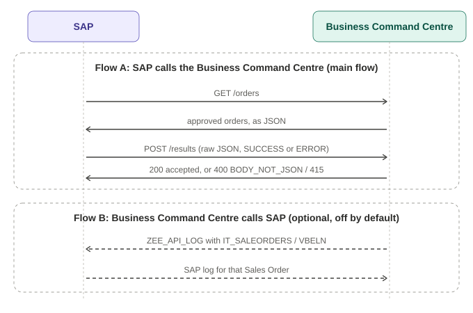

# Business Command Centre — API for SAP

This is what the SAP side needs to call the Business Command Centre: fetch the orders that are waiting, and post back the answer. It is the same exchange the folder drop does, over HTTPS.

| | |
|---|---|
| Base URL | `https://po-cockpit.onrender.com/api/integration/sap` (the hosted demo; a production deployment will have its own host) |
| Transport | HTTPS only. Never send the key over plain HTTP. |
| Authentication | One shared secret key, given to you separately (never by email or chat in clear if it can be avoided). Send it **any one** of three ways: an ordinary **HTTP Basic login** (user `sap`, the key as the password; the natural choice in ABAP), or `Authorization: Bearer <key>`, or `X-API-Key: <key>` |
| Address allow-list | If switched on, calls only work from your registered address(es). Tell us the public IP your SAP system calls from. |
| Format | JSON in, JSON out, UTF-8 |

## Overview of the two flows



Flow A (SAP calls the Business Command Centre) is the main exchange and is what this document describes. Flow B (the Business Command Centre calls SAP's `ZEE_API_LOG` for a Sales Order) is optional, off by default, and described in `02-design.md` (D-9).

## 1. Test the connection

`GET /ping` — checks the address, the key and the connection, and touches no order.

```
GET /api/integration/sap/ping
X-API-Key: <key>

200 {"ok":true,"system":"po-cockpit","time":"2026-10-05T10:00:00.000Z"}
```

## 2. Fetch the orders waiting for SAP

`GET /orders` (optional `?limit=1..100`, default 50) returns every approved order that SAP has not yet answered, oldest first. An order stays on the list **until you post its answer**, so if your job fails halfway you simply fetch it again. `GET /orders/{correlationId}` returns one.

```json
{
  "orders": [
    {
      "correlationId": "PO-9F54E6E480564949BECE0E856F067D0D",
      "attempt": 1,
      "header": {
        "poNumber": "APX-118276",
        "poDate": "2026-09-18",
        "customerCode": "C-3305",
        "customerName": "APEX FASTENER SUPPLY INC.",
        "shipTo": "…",
        "billTo": "…",
        "currency": "USD",
        "requestedDeliveryDate": "2026-10-18",
        "paymentTerms": "Net 30",
        "incoterms": "FOB",
        "poTotalValue": "4942.00"
      },
      "lines": [
        {
          "lineNumber": 1,
          "materialCode": "MAT-1042",
          "customerMaterialNumber": "X9",
          "description": "Hex bolt M10x40",
          "quantity": "4000",
          "uom": "EA",
          "unitPrice": "0.63",
          "lineNetValue": "2520.00",
          "deliveryDate": "2026-10-18",
          "plant": "1000"
        }
      ]
    }
  ],
  "problems": []
}
```

- Dates are `YYYY-MM-DD` and numbers use `.` as the decimal point and no thousands separator, whatever the customer's PO used. (Both can be changed to SAP's own formats, for example `YYYYMMDD` and a decimal comma, in the Business Command Centre's settings.)
- `correlationId` identifies the order for its whole life. `attempt` goes up by one each time a rejected order is corrected and sent again. **Send both back with your answer.**
- `problems` lists any order the Business Command Centre could not put into these formats, with the reason. It never hides one silently.

### The same order as a CSV file

`GET /orders/{correlationId}/csv` returns the order as the CSV file the folder drop writes, for a job that reads CSV and has no shared folder to read it from. It is built by the same function with the same settings, so the bytes are the ones the folder would hold, and the dates and numbers are in the same formats as the JSON above. Fetch the list first (or take the `correlationId` from the file name you were told about), then fetch each order's file.

```
GET /api/integration/sap/orders/PO-9F54E6E480564949BECE0E856F067D0D/csv
X-API-Key: <key>

200 text/csv    Content-Disposition: attachment; filename="PO_PO-9F54E6E480564949BECE0E856F067D0D_1.csv"
H,PO-9F54…,1,APX-118276,2026-09-18,C-3305,APEX FASTENER SUPPLY INC.,…,USD,2026-10-18,Net 30,FOB,4942.00
L,PO-9F54…,1,1,MAT-1042,X9,Hex bolt M10x40,4000,EA,0.63,2520.00,2026-10-18,1000
```

- One `H` row for the header, then one `L` row per line, no column-name row. The correlation ID and attempt are on every row. Header columns, in order: `REC_TYPE, CORRELATION_ID, ATTEMPT, PO_NUMBER, PO_DATE, CUSTOMER_CODE, CUSTOMER_NAME, SHIP_TO, BILL_TO, CURRENCY, REQUESTED_DELIVERY_DATE, PAYMENT_TERMS, INCOTERMS, PO_TOTAL_VALUE`. Line columns: `REC_TYPE, CORRELATION_ID, ATTEMPT, LINE_NUMBER, MATERIAL_CODE, CUSTOMER_MATERIAL_NUMBER, DESCRIPTION, QUANTITY, UOM, UNIT_PRICE, LINE_NET_VALUE, LINE_DELIVERY_DATE, PLANT`.
- Values containing the delimiter or a quote are wrapped in quotes with inner quotes doubled; line breaks inside a value become a space, so a record is always one physical line.
- If the Business Command Centre is set to write a header file and a lines file (`CSV_LAYOUT=header_lines_pair`), add `?file=H` or `?file=L` to choose one; without it the answer is `400 FILE_REQUIRED`.
- If the Business Command Centre is set to `CSV_LAYOUT=sap_flat`, the file is the SAP team's own layout instead: a header row of `PO_NUMBER, COMPANY_CODE, DOC_TYPE, CREATED_DATE, CREATED_BY, PO_ITEM, MATERIAL, PLANT, STORAGE_LOCATION, DOC_DATE, DELIVERY_DATE, CURRENCY, QUANTITY, NET_PRICE, NET_VALUE, SHORT_TEXT, ORDER_UNIT, STATUS`, then one row per item. It has no correlation ID column (the ID is in the address and the file name). `COMPANY_CODE`, `DOC_TYPE`, `STORAGE_LOCATION`, `CREATED_BY` and `STATUS` are not on a customer's PO, so they are fixed values from the Business Command Centre's settings. `CREATED_DATE` and `DOC_DATE` are both the PO date, and a line with no delivery date of its own takes the PO's requested delivery date.
- `404` and `409 NOT_WAITING_FOR_SAP` are as for `GET /orders/{correlationId}`. A value that cannot be written in these formats gives `422 ORDER_NOT_WRITABLE` with the reason, rather than a guess.
- Lines end with LF. If your job expects Windows line endings (CR+LF), the Business Command Centre can write those instead (`CSV_LINE_ENDING=crlf`): tell us. In the `sap_flat` layout a whole quantity, price or value is written without decimals (`50000`, not `50000.00`).
- There is no `.done` marker over HTTPS: the file is complete when the response ends. Posting the answer is still `POST /results`, below.

### One address, for a job that can use only one link

If your side can use only one address and cannot put an order ID in it, use `/po` for both jobs. Same login as everything else.

```
GET  /api/integration/sap/po            the oldest order still waiting for SAP, as its CSV
GET  /api/integration/sap/po?po=6100000019   the waiting order with that PO number
POST /api/integration/sap/po            the answer, named by PO number

POST body:  {"PO_NUMBER":"6100000019","VBELN":"0010002504"}
200 {"accepted":true,"applied":true,"outcome":"applied"}
```

- The `GET` reply is the CSV file (the order's ID is also in the header `X-Correlation-Id` and in the file name). An order stays the answer until its number is posted. With nothing waiting, the answer is `404 NO_ORDER_WAITING`.
- The `POST` finds the one order waiting for SAP under that PO number and records the number as its answer, exactly like the short form above (`VBELN` is up to 10 letters or digits; field names may be capitals with underscores; JSON or form fields).
- The `POST` body may also be the text a SAP job writes from two `CHAR10` fields: the PO number and the Sales Order number joined with nothing between, with an optional `sales_order:` in front (`sales_order:61000000190010002525`). The Sales Order is the last ten characters and the PO number is what comes before them (a PO number shorter than ten characters is padded with spaces and read without them). This is read whatever `Content-Type` is sent, so it does not have to be valid JSON.
- A PO number of exactly 10 characters that matches nothing is tried as the start of a longer one, because a `CHAR10` field on the SAP side cuts longer numbers.
- Nothing is guessed. No waiting order under that PO number is `404 UNKNOWN_PO_NUMBER`, and two orders under one PO number are `409 AMBIGUOUS_PO_NUMBER`. In both cases the answer is kept on file and our operations team is alerted, and nothing is applied.

### A fixed test file

`GET /test-files/{name}.csv` returns a test file the SAP team gave us, exactly as it was saved (same bytes, so a Windows or Unix line ending is kept). It is for trying your own program against the file you wrote, because the Business Command Centre cannot write every such file from a PO. It needs the key like every other address here. Only `.csv` files kept in the Business Command Centre's `backend/test-files` folder are served, by a plain name, and anything else is `404`.

```
GET /api/integration/sap/test-files/SAP_PO_test3.csv
X-API-Key: <key>

200 text/csv    Content-Disposition: attachment; filename="SAP_PO_test3.csv"
```

## 3. Post the answer

`POST /results` — one call per order.

Success:
```json
{ "correlationId": "PO-9F54E6E480564949BECE0E856F067D0D", "attempt": 1, "status": "SUCCESS", "soNumber": "4500387184" }
```

Rejection:
```json
{ "correlationId": "PO-9F54E6E480564949BECE0E856F067D0D", "attempt": 1, "status": "ERROR",
  "errorCode": "MATERIAL_NOT_FOUND", "errorMessage": "Material MAT-1042 does not exist in plant 1000" }
```

Optional: `sapTimestamp`. Field names may be camelCase (`correlationId`) or ABAP style (`CORRELATION_ID`); `status` is case-insensitive. A `SUCCESS` without `soNumber` is refused.

| Answer | Meaning | What to do |
|---|---|---|
| `200 {"accepted":true,"applied":true}` | The order is now `SO_CREATED` (or `FAILED` with your error shown to the user) | Done |
| `200 {"accepted":true,"applied":false,"duplicate":true}` | You already sent exactly this | Done; stop retrying |
| `400` `VALIDATION_ERROR` | The body is JSON but incomplete or wrong (a missing `correlationId`, an unknown `status`, a `SUCCESS` with no `soNumber`). The message names the field | Fix the field named; retrying will not help |
| `400` `BODY_NOT_JSON` | The `Content-Type` says JSON but the body is something else (for example `sales_orders=4500…`). The message shows how the body started and a correct example | Send one JSON object as shown above; retrying will not help |
| `415` `UNSUPPORTED_MEDIA_TYPE` | The body was sent as form fields or plain text instead of JSON | Set `Content-Type: application/json` and send a JSON object |
| `401` | Missing or wrong key | Check the key |
| `403` | Calling from an address that is not allowed | Ask us to add your address |
| `404 UNKNOWN_CORRELATION_ID` | No order has that ID. Kept on file and our operations team is alerted | Check the ID |
| `409 STALE_ATTEMPT` | The answer is for an earlier attempt than the order's current one. Kept on file, not applied | Fetch the order again and answer its current attempt |
| `409 NOT_WAITING_FOR_RESULT` | The order is not waiting for an answer (already answered, cancelled, or sent back). Kept on file, not applied | Nothing to do, unless you created an order you should not have: tell us |
| `429` | Too many wrong keys from your address; wait a few minutes | |
| `5xx` | Our side; the answer was **not** recorded | Retry later. Retrying is safe: the same answer is recognised as a duplicate |

An answer that arrives after we gave up waiting (our timeout is 60 minutes) is still accepted for the current attempt and completes the order.

### The short form: just the Sales Order number

If SAP's job has nothing to send back but the Sales Order number, put the order in the address and send only the number. The Business Command Centre never works out which order a bare number belongs to: the address says so. SAP already has the `correlationId` from `GET /orders`.

```
POST /api/integration/sap/orders/PO-9F54E6E480564949BECE0E856F067D0D/result
X-API-Key: <key>
Content-Type: application/json

{"VBELN":"4500387184"}

200 {"accepted":true,"applied":true,"outcome":"applied"}
```

- The body can be JSON (`{"VBELN":"4500387184"}`), form fields (`VBELN=4500387184`, `Content-Type: application/x-www-form-urlencoded`), or the number alone as plain text (`Content-Type: text/plain`). The field may also be called `soNumber` or `sales_orders`. Names may be capitals with underscores.
- It means success, for the order's current attempt. A rejection still goes to `POST /results` with an error code and message.
- One number only, up to 10 letters or digits (`VBELN` is CHAR10). A body with no number, several numbers, or anything else is `400 VALIDATION_ERROR`, naming what was received, and nothing is changed. Leading zeros are kept as sent.
- Every other answer is the same as for `POST /results`: `200` with `"duplicate":true` for a repeat, `404 UNKNOWN_CORRELATION_ID`, `409 NOT_WAITING_FOR_RESULT`, `409 STALE_ATTEMPT`.

## 4. How often

Fetch every 1–5 minutes. There is no need to remember what you have already fetched: an order leaves the list when you answer it.

## 5. If your answer is not JSON yet: the capture address

`POST /echo` takes **any** body (JSON, form fields, text, an internal table written out as text) and keeps it exactly as sent, without applying anything to any order. Point your program at it first, with the same login as everything else, and the Business Command Centre side can then write the mapping from a real example instead of a description.

```
POST /api/integration/sap/echo
200 {"received":true,"bytes":74,"kind":"delimited","delimiter":"tab","headers":{…},"preview":"VBELN\tBSTNK\t…"}
```

- `kind` is the Business Command Centre's guess at the format: `json`, `form` (`name=value`, as in `sales_orders=…`, with each field's own kind listed), `delimited` (rows split by tab, `;`, `|` or `,`), `xml`, `text`, `binary` or `empty`. The reply also echoes the headers that matter (never the key) and the first 2,000 characters.
- `GET /echo` returns the latest 20 captures, newest first, with the full text (up to 20,000 characters each). They are held in the server's memory, so a restart clears them; every capture is also written to the server log as `SAP API capture`.
- It needs the key, like every other address here, and a body over 1 MB is refused. Switch it off with `SAP_API_CAPTURE=false` once the real format is handled.
- Please send a few real rows, not one, and include any fields that are empty in your real data.

## 6. From ABAP, in outline

Create an HTTP client for the URL (SM59 or `cl_http_client=>create_by_url`), log in with `client->authenticate( username = 'sap' password = lv_key )` (or set `request->set_header_field( name = 'X-API-Key' value = lv_key )`), `set_method( 'GET' )` for the list and `'POST'` with `Content-Type: application/json` for answers, and (de)serialise with `/ui2/cl_json`. Keep the key in secure storage (SSFA / a secure parameter), not in the program.
